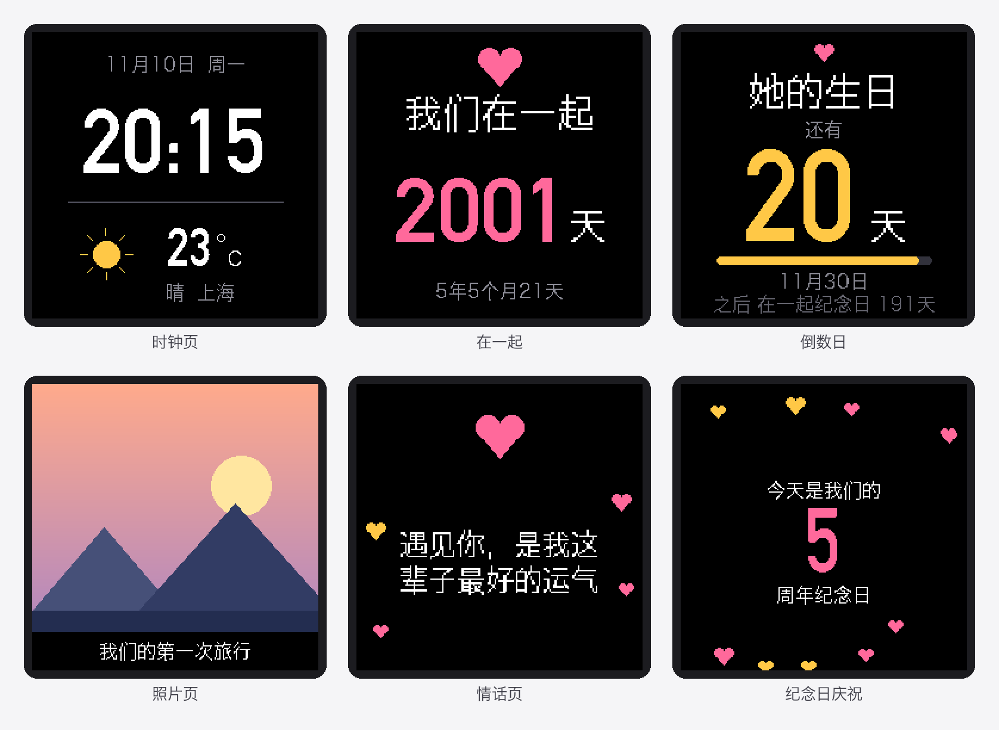
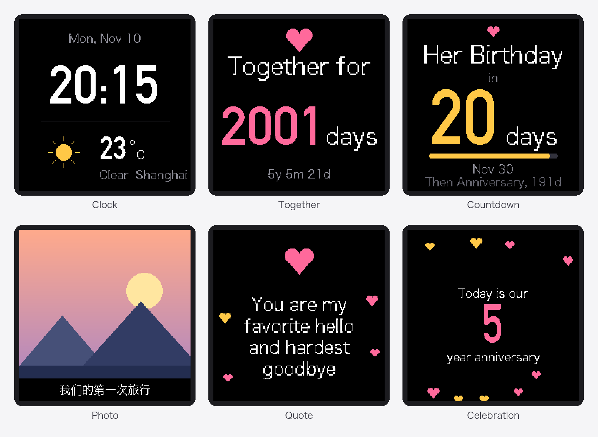
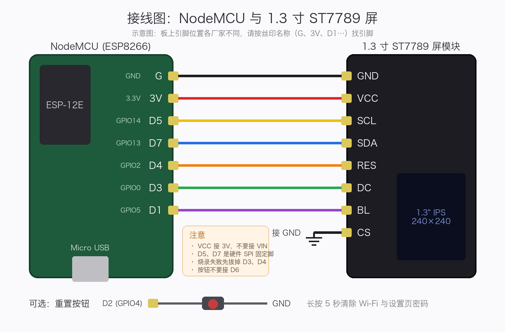
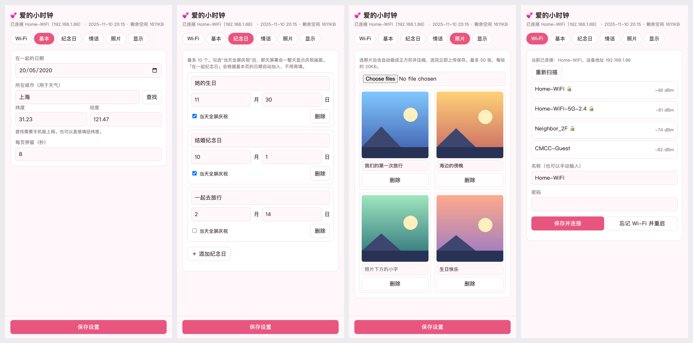
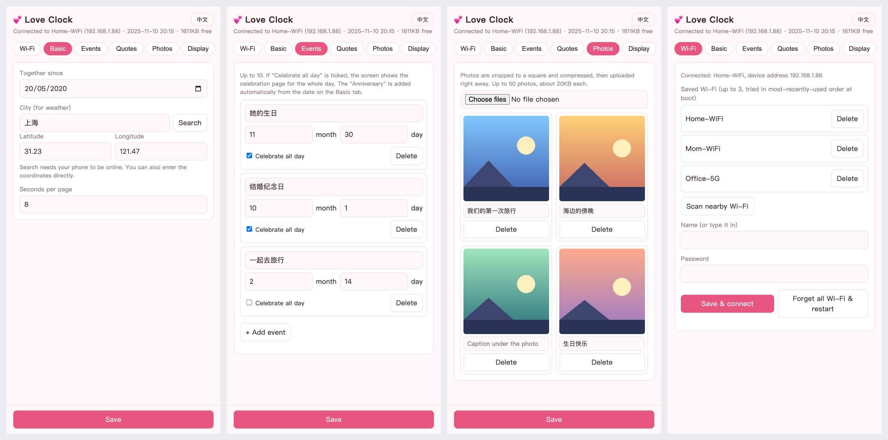

# 爱的小时钟 (Love Clock)

一个用 NodeMCU (ESP8266) 和 1.3 寸 IPS 屏做的桌面小时钟，适合当纪念日礼物。

> **English summary:** A desk clock for anniversary gifts, built with a NodeMCU (ESP8266) and a 1.3" 240×240 ST7789 IPS display. It rotates between a clock with weather, days together, event countdowns, random photos and love quotes, and shows a full-screen celebration on special days. Everything (Wi-Fi provisioning, events, photos, quotes) is configured from a phone web page, with a Chinese / English UI. Arduino IDE project, GPL-3.0.

屏幕自动轮播：时钟与天气、在一起的天数、倒数日、照片、情话。纪念日当天整天显示庆祝画面。**所有设置都在手机网页里完成，包括 Wi-Fi 配网和照片上传，不需要改代码、不需要重新烧录。**



> 图为按固件布局渲染的示意图（照片页为合成图），字体和实机的点阵字体略有差别，不是实机照片。

屏幕和设置页支持**中文 / English** 切换（设置页右上角按钮，两者同步）。英文版屏幕预览：



灵感来自网上流行的"太空人天气时钟"，硬件相同，软件从头写，功能面向纪念和礼物场景。

## 功能

| 页面 | 内容 |
|---|---|
| 时钟 | 大号时间、日期、星期、天气图标、温度（Open-Meteo，免注册） |
| 在一起 | "我们在一起 N 天"，下面是几年几个月几天 |
| 倒数日 | 最近的纪念日，大字显示还有多少天，带进度条，并预告下一个 |
| 照片 | 随机显示你上传的照片，可带一行小字 |
| 情话 | 随机一句，中间的爱心跳动，两侧爱心飘升 |
| 庆祝页 | 纪念日当天锁定全屏显示，爱心飘动 |

其他：

- 手机网页设置：在一起的日期、城市、纪念日（最多 10 个）、情话（约 50 句）、照片（最多 50 张）、亮度、夜间自动调暗、设置页密码。
- 中英文切换：设置页右上角的按钮，屏幕文字和网页同时切换。
- 热点配网：首次开机自己开热点，手机连上后设置页自动弹出。
- 照片在浏览器里自动裁成 240×240 并压缩，选完立即上传。
- 预览功能：设置页可以"假装今天是某天"，不用等到纪念日就能看庆祝页。
- 断网时时钟继续走，连不上路由器超过 2 分钟会重新开热点。

## 硬件

| 物品 | 说明 |
|---|---|
| NodeMCU 开发板 | ESP8266，ESP-12E，带 USB（CH340 或 CP2102） |
| 1.3 寸 IPS 屏 | ST7789 驱动，240×240，SPI 接口，3.3V 版本 |
| 杜邦线 | 母对母 7 根（按钮可选，再加 1 根） |
| Micro USB 线 | 供电和烧录，请用能传数据的线 |
| 按钮 | 可选，用于忘记密码时恢复出厂 |

1.3 寸屏模块常见 7 针或 8 针版本。7 针版本没有 CS 引脚（模块上已通过 J2 短接线接地）。本项目按"CS 接地、软件不控制 CS"设计，8 针版本的 CS 也请接 GND。

## 3D 打印外壳

配套的外壳模型可以在 Thingiverse 下载：**[thing:6388626](https://www.thingiverse.com/thing:6388626)**（STL 文件、打印建议和装配说明见该页面）。

## 接线



文字版：

```
  1.3 寸屏模块              NodeMCU
 ┌───────────┐          ┌─────────────┐
 │ GND       ├──────────┤ G  (GND)    │
 │ VCC       ├──────────┤ 3V (3.3V)   │
 │ SCL (SCK) ├──────────┤ D5 (GPIO14) │
 │ SDA (MOSI)├──────────┤ D7 (GPIO13) │
 │ RES       ├──────────┤ D4 (GPIO2)  │
 │ DC        ├──────────┤ D3 (GPIO0)  │
 │ BL        ├──────────┤ D1 (GPIO5)  │
 │ CS        ├── GND    │             │
 └───────────┘          └─────────────┘
```

| 屏幕 | NodeMCU | GPIO | 说明 |
|---|---|---|---|
| GND | G | - | 地 |
| VCC | 3V | - | **接 3.3V，不要接 VIN/5V** |
| SCL (SCK) | D5 | 14 | 硬件 SPI 时钟 |
| SDA (MOSI) | D7 | 13 | 硬件 SPI 数据 |
| RES | D4 | 2 | 复位 |
| DC | D3 | 0 | 数据/命令选择 |
| BL | D1 | 5 | 背光，PWM 调光 |
| CS | GND | - | 片选，常接地 |

可选按钮：一端接 **D2 (GPIO4)**，另一端接 **GND**。长按 5 秒清除 Wi-Fi 信息和设置页密码并重启。

引脚在 `display.h`（屏幕）和 `love_clock.ino`（按钮）里改。注意：

- D5 和 D7 是硬件 SPI 的固定引脚，不能换。
- D3 (GPIO0) 和 D4 (GPIO2) 是启动配置引脚，接屏幕没问题，但烧录时若失败，先拔掉这两根线再试。
- 不要把按钮接 D6 (GPIO12)，它是 SPI 的 MISO，会被占用。

## 软件环境

| 项目 | 版本 |
|---|---|
| Arduino IDE | 2.x |
| ESP8266 开发板包 | 3.1.2（其他 3.x 应该也行） |
| Adafruit GFX Library | 最新版 |
| Adafruit ST7735 and ST7789 Library | 最新版 |
| U8g2_for_Adafruit_GFX | 最新版，**需要打一个补丁，见下** |
| TJpg_Decoder | 最新版 |
| ArduinoJson | **6.x（如 6.21.5），不能用 7.x** |

开发板包地址（Arduino IDE 设置 → 其他开发板管理器地址）：

```
http://arduino.esp8266.com/stable/package_esp8266com_index.json
```

### 必须：给 U8g2_for_Adafruit_GFX 打补丁

这个库没有为 ESP8266 把字体放进闪存，318KB 的中文字体会被放进只有 80KB 的 RAM，链接时报：

```
section `.rodata' will not fit in region `dram0_0_seg'
```

修改库里的 `src/u8g2_fonts.h`（路径一般是 `~/Documents/Arduino/libraries/U8g2_for_Adafruit_GFX/src/u8g2_fonts.h`），找到：

```c
#if defined(__GNUC__) && defined(__AVR__)
#  define U8X8_FONT_SECTION(name) U8X8_SECTION(".progmem." name)
```

在它前面加一段 ESP8266 分支，并把 `#if` 改成 `#elif`：

```c
#if defined(ESP8266)
#  include <pgmspace.h>
#  define U8X8_FONT_SECTION(name) PROGMEM
#  define u8x8_pgm_read(adr) pgm_read_byte(adr)
#  define U8X8_PROGMEM PROGMEM
#elif defined(__GNUC__) && defined(__AVR__)
#  define U8X8_FONT_SECTION(name) U8X8_SECTION(".progmem." name)
#  define u8x8_pgm_read(adr) pgm_read_byte_near(adr)
#  define U8X8_PROGMEM PROGMEM
#endif
```

库更新后补丁会被覆盖，需要重新打。

## 编译和烧录

1. 按上面装好开发板包和库，打补丁。
2. 打开 `love_clock/love_clock.ino`。
3. 工具菜单设置：
   - 开发板：**NodeMCU 1.0 (ESP-12E Module)**
   - Flash Size：**4MB (FS:2MB OTA:~1019KB)**
   - Upload Speed：921600（不稳定就降到 115200）
   - 端口：选你的 USB 串口
4. 点 Verify 确认编译通过，再点 Upload。

设置网页内嵌在固件里，**不需要**另外上传文件系统。第一次编译较慢，因为字体库的源文件有 30MB。

Mac 上若看不到串口，需要安装 CH340 驱动（WCH 官网搜 "CH34x Mac driver"）。CP2102 板子需要 Silicon Labs 的驱动。

## 第一次使用

1. 上电。屏幕显示"请连接热点 LoveClock-Setup"。
2. 手机连 Wi-Fi 热点 `LoveClock-Setup`（无密码）。设置页会自动弹出，没弹出就浏览器打开 `192.168.4.1`。
3. 在 **Wi-Fi** 标签点"扫描"，选家里的 Wi-Fi，输入密码，点"保存并连接"。
4. 连接成功后屏幕会显示设备 IP。设备会记住最近用过的 3 个 Wi-Fi（比如家里、岳母家、公司），开机时自动连周围搜得到的那个，可以在 Wi-Fi 标签里删除。手机切回家里的 Wi-Fi，浏览器打开 `http://love-clock.local`（或屏幕上的 IP）。
5. 依次填：
   - **基本**：在一起的日期、城市（点"查找"自动填经纬度）、每页停留秒数。
   - **纪念日**：名称、月日，勾选"当天全屏庆祝"。
   - **情话**：一行一句。
   - **照片**：选图后自动上传，可写一行小字。
   - **显示**：白天和夜间亮度、夜间时段、设置页密码。
6. 点底部"保存设置"，屏幕立即更新。

"在一起纪念日"会根据你填的日期自动加入倒数和庆祝，不用再手动添加。



英文界面：



> 设置页截图使用的是示例数据。

只支持 2.4GHz Wi-Fi。

## 工作原理

- **页面轮播**：`loop()` 里是一个简单的状态机，模式有配网提示、连接信息、轮播、庆祝。轮播时按设定秒数切换页面，时钟页只局部刷新分钟数字，避免闪烁。
- **显示**：Adafruit_ST7789 驱动，无 CS 脚，初始化用 `SPI_MODE2`。ESP8266 内存只有约 40KB，放不下整屏缓冲，所以不整屏重绘。
- **中文**：U8g2 的文泉驿 16 像素字体放进闪存。放大的中文通过 1 位画布逐行放大 2 倍绘制。
- **照片**：LittleFS 中的 JPEG，由 TJpg_Decoder 解码。浏览器端已裁成 240×240 baseline JPEG，每张约 20KB。
- **天气**：Open-Meteo 的 `current` 接口，每 30 分钟更新，失败 2 分钟后重试。城市到经纬度的转换在浏览器里调用 Open-Meteo 的地理编码接口，所以设备本身不需要解析城市。
- **时间**：NTP（阿里云），固定东八区。
- **配置**：`/config.json`、`/wifi.json`、`/quotes.txt` 存在 LittleFS，断电不丢。
- **网页**：一个内嵌在固件里的单页应用，通过 `/api/*` 与设备通信。

## 文件说明

| 文件 | 作用 |
|---|---|
| `love_clock.ino` | 主程序：模式状态机、天气定时、按钮 |
| `config_store.h` | 设置的数据结构、JSON 读写 |
| `display.h` | 屏幕驱动、日期计算、各页面绘制、庆祝页和动画 |
| `weather.h` | 天气请求与解析 |
| `web_ui.h` | 热点配网、强制门户、设置页后端接口 |
| `web_page.h` | 内嵌的设置网页（HTML/CSS/JS），含中英文切换 |
| `docs/` | README 用的图：`screens.png`、`screens_en.png`（屏幕）、`wiring.png`（接线）、`web.png`、`web_en.png`（设置页） |

## 常见问题

| 现象 | 处理 |
|---|---|
| 编译报 `.rodata will not fit in region dram0_0_seg` | 没打 U8g2 补丁，见上 |
| 编译报 `'D3' was not declared` | 开发板没选 NodeMCU 1.0；本项目已改用 GPIO 编号，更新到最新代码 |
| 编译报 `ArduinoJson.h` 或 `TJpg_Decoder.h` 找不到 | 对应的库没装 |
| ArduinoJson 相关的奇怪编译错误 | 装成了 7.x，换成 6.21.5 |
| 屏幕全白、花屏 | 检查接线；确认 `tft.init(240, 240, SPI_MODE2)` |
| 偶尔花屏 | `display.h` 里 `setSPISpeed(32000000)` 改成 `20000000` |
| 屏幕上下颠倒 | `display.h` 里 `tft.setRotation(2)` 改成 `0` |
| 背光不亮 | 检查 BL 接 D1；个别模块背光低电平有效，需要反过来 |
| 照片颜色发红或发蓝 | `display.h` 里 `JPG_SWAP` 改成 `true` |
| 开机几秒后反复重启 | 供电不足（换短线或换 USB 口），或杜邦线松动 |
| 手机连热点后没有弹出设置页 | 手动打开 `192.168.4.1`；部分手机需要关闭移动数据 |
| `love-clock.local` 打不开 | 安卓部分机型不支持 mDNS，改用屏幕上显示的 IP |
| 换了地方，想重新配网 | 连按两次板子上的 RST 键（3 秒内），屏幕显示"请连接热点"，只开热点不连路由器；5 分钟没操作会自动恢复正常 |
| 忘记设置页密码 | 接了按钮就长按 5 秒；没接就重新烧录并选择 Erase All Flash Contents |
| 编译提示固件太大 | 字体换成较小字符集 `u8g2_font_wqy16_t_gb2312a`（需改 `F_CN`） |

## 限制

- 只支持 2.4GHz Wi-Fi。
- 时区固定为东八区。
- 英文界面只翻译固件和网页自带的文字；你填的纪念日名称、照片说明、情话不会自动翻译，想显示英文需要自己填英文。
- 最多记住 3 个 Wi-Fi，新增第 4 个会淘汰最久没用的。
- 设置页是明文 HTTP，只在局域网内使用；密码仅用于防止误改，不是严格的安全措施。
- 纪念日最多 10 个，照片最多 50 张，情话约 50 句（总计受 2MB 文件系统限制）。
- 16 像素中文字体放大后边缘有锯齿。
- 天气数据依赖 Open-Meteo，在个别网络环境下可能不可达。

## 后续想法

- 远程小纸条：手机网页或消息机器人发一句话，屏幕立即显示并蜂鸣提示。
- 双机互动：两块板子通过 MQTT 互发爱心动画。
- 换 ESP32-S3 获得更流畅的动画。

## 许可

本项目以 [GPL-3.0](LICENSE) 协议开源。Copyright (C) 2026 Jacob12138xieyuan。

使用的第三方库和字体各自遵循自己的协议，不受本协议影响。
